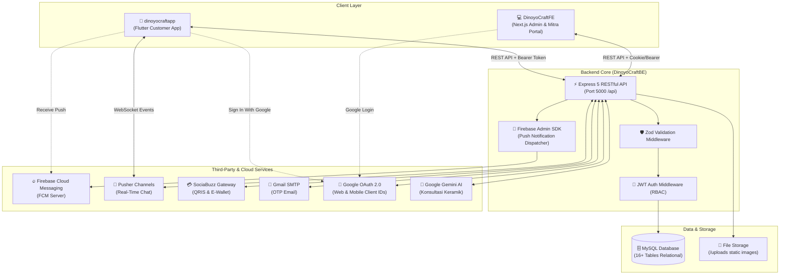
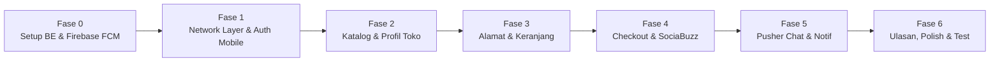

# 📘 PRD & Panduan Integrasi: DinoyoCraft Mobile ke Backend RESTful API

**Dokumen**: Product Requirements Document (PRD) & Technical Integration Roadmap  
**Aplikasi Mobile**: `dinoyocraftmobile` (Flutter 3.x / Dart 3.x)  
**Backend**: `DinoyoCraftBE` (Node.js 20+, Express 5.x, TypeScript, MySQL 8.x, Pusher, SociaBuzz, Firebase Admin)  
**Web Dashboard**: `DinoyoCraftFE` (Next.js 15, Tailwind CSS, Portal Admin & Mitra)  
**Tanggal Update**: 31 Oktober 2026  
**Status**: Ready for Implementation (Jobdesk BE & Mobile Ready)  

---

## 1. Ringkasan Eksekutif & Arsitektur Ekosistem

Platform **DinoyoCraft** adalah ekosistem digital e-commerce dan reservasi workshop keramik khas Kampung Wisata Keramik Dinoyo, Kota Malang. Ekosistem ini terdiri dari tiga subsistem utama:

1. **`DinoyoCraftBE` (Backend Core)**: Single source of truth yang mengelola basis data relasional (MySQL 16 tabel), autentikasi JWT & Google OAuth, integrasi pembayaran SociaBuzz (QRIS/VA), pengiriman email OTP (Nodemailer), obrolan realtime (Pusher Channels), mesin AI Gemini, serta pengiriman push notification via Firebase Cloud Messaging (FCM).
2. **`DinoyoCraftFE` (Web Portal)**: Aplikasi Next.js khusus untuk **Admin** (moderasi, verifikasi mitra, master data) dan **Mitra Pengrajin** (manajemen katalog toko, pemrosesan pesanan, laporan keuangan).
3. **`dinoyocraftapp` (Mobile Flutter)**: Aplikasi smartphone khusus untuk **Pengunjung / Pelanggan (Customer)** untuk menjelajahi katalog keramik, reservasi workshop, buku alamat, keranjang belanja, checkout QRIS, memberi ulasan produk, menerima notifikasi push status pesanan, serta live chat dengan toko keramik.



---

## 2. Temuan Analisis & Kesenjangan (Gap Analysis)

Berdasarkan penelusuran mendalam terhadap basis kode `DinoyoCraftBE`, `DinoyoCraftFE`, dan `dinoyocraftapp`, ditemukan beberapa poin krusial yang harus diselaraskan:

### 2.1. Gap Autentikasi Pengunjung (Customer) di Backend
- **Kondisi Saat Ini di BE**:
  - Tabel `users` di database sudah mendukung enum peran: `'admin'`, `'mitra'`, dan `'pengunjung'`.
  - Namun pada `authController.ts` fungsi `loginMitra` (yang saat ini menangani rute `/api/auth/login`), terdapat guard clause pembatas:
    ```typescript
    if (user.role !== 'mitra' && user.role !== 'admin') {
      res.status(403).json({ message: 'Akses ditolak. Akun ini bukan akun Mitra.' });
      return;
    }
    ```
  - Registrasi yang tersedia di `/api/auth/register-mitra` mewajibkan berkas KTP, NIB, dan sampel foto produk toko. Belum ada endpoint pendaftaran untuk pembeli umum (`registerCustomer`).
- **Solusi Integrasi**:
  1. Perluas rute autentikasi di BE:
     - Tambahkan `POST /api/auth/register-customer` (hanya butuh: `name`, `email`, `password`, dan opsi `phone`).
     - Buka batasan di `POST /api/auth/login` agar mengizinkan semua role (`admin`, `mitra`, dan `pengunjung`).

### 2.2. Gap Google OAuth 2.0 Multi-Platform (Web vs Mobile)
- **Kondisi Saat Ini di BE**:
  - `authController.ts` pada fungsi `googleLogin` memvalidasi token hanya dengan 1 `audience`:
    ```typescript
    const ticket = await client.verifyIdToken({
      idToken: credential,
      audience: process.env['GOOGLE_CLIENT_ID'],
    });
    ```
  - Saat ada pengguna baru login Google, BE otomatis memaksa membuat akun baru dengan `role: 'mitra'` dan membuat entri dummy di `mitra_profiles`.
- **Solusi Integrasi**:
  1. **Google Cloud Console Kredensial Terpisah**:
     - **Client ID 1 (Web Application)**: Untuk Next.js Web (`DinoyoCraftFE`). Memerlukan *Authorized JavaScript Origins* (`http://localhost:3000`).
     - **Client ID 2 (Android Application)**: Untuk Flutter Mobile (`dinoyocraftapp`). Memerlukan **Package Name** (`com.example.dinoyocraftmobile`) dan **SHA-1 Certificate Fingerprint** dari laptop developer.
  2. **Multi-Audience Verification di Backend**:
     - Backend memvalidasi `audience` berupa array yang mencakup Client ID Web dan Mobile.
  3. **Penentuan Peran Otomatis (Auto-Role)**:
     - Jika request login Google datang dari aplikasi mobile (atau ada flag `platform: 'mobile'`), akun baru dibuat dengan **`role: 'pengunjung'`** tanpa perlu toko dummy.

### 2.3. Gap Katalog Publik Produk & Toko di Backend
- **Kondisi Saat Ini di BE**:
  - `GET /api/products` saat ini memanggil `getProdukMitra` yang **memerlukan token login Mitra** dan hanya menampilkan produk milik mitra yang login.
  - Toko mitra saat ini hanya memiliki `GET /api/mitra/store-profile` (khusus mitra terautentikasi).
- **Solusi Integrasi**:
  1. Tambahkan endpoint publik di BE untuk konsumsi Mobile App:
     - `GET /api/products/public`: Katalog produk gabungan dari semua mitra aktif dengan query: `?category=...&search=...&sort=...&page=...`.
     - `GET /api/products/:id/public`: Detail produk lengkap beserta varian, stok, ulasan, rating, dan identitas toko mitra.
     - `GET /api/mitra/public`: Daftar seluruh toko pengrajin Dinoyo yang aktif dan terverifikasi.
     - `GET /api/mitra/:id/public`: Profil toko pengrajin beserta daftar produk yang dijualnya.

### 2.4. Gap Firebase Cloud Messaging (FCM) & Push Notifications
- **Kondisi Saat Ini**:
  - Di Mobile Flutter, kode `FcmService` ([fcm_service.dart](file:///c:/dinoyocraftapp/lib/core/services/fcm_service.dart)) sudah disiapkan lengkap dengan fallback safe, listener foreground, background handler, dan request izin Android 13+. Namun berkas `google-services.json` dan plugin Gradle Google Services belum dipasang.
  - Di Backend (`DinoyoCraftBE`), belum ada tabel penyimpanan FCM Token, belum ada endpoint `POST /api/user/fcm-token`, dan belum ada instalasi `firebase-admin` untuk mengirimkan notifikasi saat status pesanan berubah atau ada chat masuk.
- **Solusi Integrasi**:
  - Buat proyek Firebase di Firebase Console dan sambungkan kedua sisi (Mobile & Backend) mengikuti panduan lengkap di Bagian 4 dokumen ini.

---

## 3. 📋 Spesifikasi & Action Items untuk Developer Backend (Jobdesk BE)

Bagian ini dirancang agar dapat langsung dikerjakan oleh rekan developer Backend (`DinoyoCraftBE`).

### Task 1: Konfigurasi Environment & Google OAuth Multi-Platform
1. Perbarui template berkas `.env` dan `.env.example`:
   ```env
   # Google OAuth 2.0 Multi-Platform
   GOOGLE_CLIENT_ID_WEB=xxxx-web.apps.googleusercontent.com
   GOOGLE_CLIENT_ID_MOBILE=yyyy-mobile.apps.googleusercontent.com
   ```
2. Modifikasi fungsi `googleLogin` di `src/controllers/authController.ts`:
   ```typescript
   // 1. Verifikasi Multi-Audience (Web & Mobile)
   const validAudiences = [
     process.env.GOOGLE_CLIENT_ID_WEB,
     process.env.GOOGLE_CLIENT_ID_MOBILE,
     process.env.GOOGLE_CLIENT_ID, // fallback legacy
   ].filter(Boolean) as string[];

   const ticket = await client.verifyIdToken({
     idToken: credential,
     audience: validAudiences,
   });
   
   // 2. Tentukan Role Pengguna Baru:
   // Jika platform === 'mobile' atau dipanggil dari app pembeli, jadikan 'pengunjung'
   const platform = req.body.platform || 'web';
   const userRole = platform === 'mobile' ? 'pengunjung' : 'mitra';

   if (isNewUser) {
     const [insertUser]: any = await connection.query(
       'INSERT INTO users (name, email, role, is_active, google_id, avatar_url) VALUES (?, ?, ?, 1, ?, ?)',
       [name, email, userRole, googleId || null, avatarUrl || null]
     );
     
     // Hanya buat profil mitra jika role-nya mitra
     if (userRole === 'mitra') {
       await connection.query(
         'INSERT INTO mitra_profiles (user_id, store_name, ...) VALUES (?, ?, ...)',
         [insertUser.insertId, 'Toko ' + name]
       );
     }
   }
   ```

### Task 2: Registrasi & Login Pengunjung (Customer)
1. Buat skema validasi baru di `src/validators/schemas.ts`:
   ```typescript
   export const registerCustomerSchema = z.object({
     name: z.string().min(2, 'Nama minimal 2 karakter'),
     email: z.string().email('Format email tidak valid'),
     password: z.string().min(6, 'Password minimal 6 karakter'),
     phone: z.string().optional(),
   });
   ```
2. Tambahkan controller `registerCustomer` di `src/controllers/authController.ts`:
   - Enkripsi password menggunakan `bcrypt.hash(password, 10)`.
   - Simpan ke tabel `users` dengan `role = 'pengunjung'` dan `is_active = 1`.
   - Return format respons sukses standar beserta JWT access token.
3. Modifikasi fungsi `loginMitra` di `src/controllers/authController.ts`:
   - **Hapus pengecekan batasan**:
     ```typescript
     // HAPUS ATAU UBAH BARIS INI:
     // if (user.role !== 'mitra' && user.role !== 'admin') { ... }
     ```
   - Izinkan user dengan role `pengunjung` mendapatkan token login.

### Task 3: Endpoint Publik Katalog Produk (`/api/products/public`)
1. Di `src/routes/productRoutes.ts`, daftarkan rute publik (tanpa middleware `verifyToken`):
   ```typescript
   router.get('/public', getPublicProducts);
   router.get('/:id/public', getPublicProductDetail);
   ```
2. Logika `getPublicProducts`:
   - Query: `SELECT p.*, c.name AS category_name, m.store_name, m.rating AS store_rating FROM products p JOIN categories c ... JOIN mitra_profiles m ... WHERE p.is_deleted = 0 AND m.is_verified = 1`.
   - Mendukung filter `?category=...`, `?search=...`, sort by harga/terbaru, dan paginasi `?page=1&limit=20`.

### Task 4: Endpoint Publik Profil Toko Mitra (`/api/mitra/public`)
1. Di `src/routes/mitraRoutes.ts`, daftarkan rute:
   ```typescript
   router.get('/public', getPublicMitraStores);
   router.get('/:id/public', getPublicMitraDetail);
   ```
2. Mengembalikan informasi toko keramik Dinoyo: nama toko, alamat workshop, deskripsi, avatar, banner, rating, dan daftar produk keramik milik toko tersebut.

### Task 5: Konfigurasi Host & CORS untuk Akses Mobile
1. Pastikan server listener di `src/server.ts` mendengarkan di host `0.0.0.0` (bukan hanya `127.0.0.1` / `localhost`):
   ```typescript
   app.listen(PORT, '0.0.0.0', () => {
     console.log(`Server DinoyoCraftBE aktif di http://0.0.0.0:${PORT}`);
   });
   ```
2. Pastikan middleware CORS di `src/app.ts` mengizinkan request dari client mobile (origin `*` atau pengecekan yang tidak memblokir client native tanpa `Origin` header browser).

---

## 4. 🔥 Panduan Lengkap Setup Firebase & Push Notification FCM (End-to-End)

Bagian ini memandu langkah demi langkah menyiapkan Firebase dari nol hingga notifikasi berhasil terkirim ke smartphone.

### 4.1. Langkah 1: Buat Proyek di Firebase Console
1. Buka [Firebase Console](https://console.firebase.google.com/) dan login dengan akun Google.
2. Klik **"Add project"** (Tambah proyek) -> Beri nama: **`DinoyoCraft`**.
3. Nonaktifkan atau aktifkan Google Analytics sesuai kebutuhan -> Klik **Create Project**.

### 4.2. Langkah 2: Daftarkan Aplikasi Android di Firebase Console
1. Di dashboard proyek Firebase, klik ikon **Android** (`+ Add app`).
2. Masukkan data:
   - **Android package name**: `com.example.dinoyocraftmobile` (harus sama persis dengan `namespace` dan `applicationId` di [build.gradle.kts](file:///c:/dinoyocraftapp/android/app/build.gradle.kts#L8-L19)).
   - **App nickname**: `DinoyoCraft Mobile`
   - **Debug signing certificate SHA-1**:
     - Ambil SHA-1 laptop Anda dengan menjalankan perintah ini di PowerShell:
       ```powershell
       cd C:\dinoyocraftapp\android
       ./gradlew signingReport
       ```
     - Salin nilai SHA-1 dari `Variant: debugAndroidTest / debug` dan tempelkan ke Firebase Console.
3. Klik **Register app**.
4. Klik **Download `google-services.json`**.
5. Simpan file tersebut ke direktori proyek Flutter:
   📍 `C:\dinoyocraftapp\android\app\google-services.json`

### 4.3. Langkah 3: Konfigurasi Gradle Android (Kotlin DSL `.kts`)
Di proyek Flutter kita, Android menggunakan skrip Gradle Kotlin DSL modern:

1. Buka [android/settings.gradle.kts](file:///c:/dinoyocraftapp/android/settings.gradle.kts) dan tambahkan plugin Google Services:
   ```kotlin
   plugins {
       id("dev.flutter.flutter-plugin-loader") version "1.0.0"
       id("com.android.application") version "9.1.0" apply false
       id("org.jetbrains.kotlin.android") version "2.4.0" apply false
       id("com.google.gms.google-services") version "4.4.2" apply false // <-- TAMBAHKAN INI
   }
   ```

2. Buka [android/app/build.gradle.kts](file:///c:/dinoyocraftapp/android/app/build.gradle.kts) dan terapkan plugin:
   ```kotlin
   plugins {
       id("com.android.application")
       id("dev.flutter.flutter-gradle-plugin")
       id("com.google.gms.google-services") // <-- TAMBAHKAN INI
   }
   ```

3. Buka [android/app/src/main/AndroidManifest.xml](file:///c:/dinoyocraftapp/android/app/src/main/AndroidManifest.xml) dan pastikan izin notifikasi Android 13+ aktif di dalam tag `<manifest>`:
   ```xml
   <uses-permission android:name="android.permission.INTERNET"/>
   <uses-permission android:name="android.permission.POST_NOTIFICATIONS"/>
   <uses-permission android:name="android.permission.VIBRATE"/>
   ```

### 4.4. Langkah 4: Setup Firebase Admin SDK di Backend (`DinoyoCraftBE`)
Agar backend Node.js bisa mengirimkan Push Notification ke HP pengguna:

1. **Unduh Private Key Service Account**:
   - Di Firebase Console, klik ikon roda gigi ⚙️ (**Project settings**) -> Tab **Service accounts**.
   - Klik tombol **"Generate new private key"** -> Konfirmasi.
   - Sebuah file JSON rahasia (contoh: `dinoyocraft-firebase-adminsdk-xxxxx.json`) akan terunduh.
   - Pindahkan file ini ke folder konfigurasi backend:
     📍 `C:\DinoyoCraftBE\src\config\firebase-service-account.json` (pastikan nama file ini dimasukkan ke `.gitignore` BE).

2. **Tambahkan Variabel di `.env` Backend**:
   ```env
   # Firebase Admin SDK Configuration
   FIREBASE_SERVICE_ACCOUNT_PATH=./src/config/firebase-service-account.json
   ```

3. **Install Pustaka `firebase-admin` di Backend**:
   ```bash
   cd C:\DinoyoCraftBE
   npm install firebase-admin
   ```

4. **Inisialisasi Firebase Admin di Backend** (`src/config/firebase.ts`):
   ```typescript
   import admin from 'firebase-admin';
   import fs from 'fs';
   import path from 'path';

   const serviceAccountPath = process.env.FIREBASE_SERVICE_ACCOUNT_PATH || './src/config/firebase-service-account.json';
   const resolvedPath = path.resolve(process.cwd(), serviceAccountPath);

   if (fs.existsSync(resolvedPath)) {
     const serviceAccount = JSON.parse(fs.readFileSync(resolvedPath, 'utf8'));
     admin.initializeApp({
       credential: admin.credential.cert(serviceAccount),
     });
     console.log('✅ Firebase Admin SDK berhasil diinisialisasi.');
   } else {
     console.warn('⚠️ File Firebase service account tidak ditemukan di:', resolvedPath);
   }

   export default admin;
   ```

### 4.5. Langkah 5: Migrasi Database & Endpoint Sync Token di Backend
1. **Buat Tabel `user_device_tokens` di MySQL**:
   Jalankan query DDL berikut di database `dinoyocraft_db`:
   ```sql
   CREATE TABLE IF NOT EXISTS `user_device_tokens` (
     `id` int UNSIGNED NOT NULL AUTO_INCREMENT,
     `user_id` int UNSIGNED NOT NULL,
     `fcm_token` varchar(255) COLLATE utf8mb4_unicode_ci NOT NULL,
     `platform` varchar(20) COLLATE utf8mb4_unicode_ci DEFAULT 'android',
     `updated_at` datetime NOT NULL DEFAULT CURRENT_TIMESTAMP ON UPDATE CURRENT_TIMESTAMP,
     PRIMARY KEY (`id`),
     UNIQUE KEY `uq_user_device_token` (`user_id`, `fcm_token`),
     KEY `idx_tokens_user` (`user_id`),
     CONSTRAINT `fk_tokens_user` FOREIGN KEY (`user_id`) REFERENCES `users` (`id`) ON DELETE CASCADE
   ) ENGINE=InnoDB DEFAULT CHARSET=utf8mb4 COLLATE=utf8mb4_unicode_ci;
   ```

2. **Buat Endpoint Simpan Token (`POST /api/user/fcm-token`)**:
   - Di `src/routes/authRoutes.ts` atau `src/routes/notificationRoutes.ts`:
     ```typescript
     router.post('/fcm-token', verifyToken, async (req: Request, res: Response) => {
       const userId = res.locals.userId;
       const { fcm_token, platform = 'android' } = req.body;

       if (!fcm_token) {
         return res.status(400).json({ success: false, message: 'FCM Token wajib dikirim' });
       }

       await pool.query(
         `INSERT INTO user_device_tokens (user_id, fcm_token, platform)
          VALUES (?, ?, ?)
          ON DUPLICATE KEY UPDATE platform = VALUES(platform), updated_at = NOW()`,
         [userId, fcm_token, platform]
       );

       return res.status(200).json({ success: true, message: 'FCM token berhasil disinkronkan' });
     });
     ```

3. **Helper Fungsi Pengiriman Notifikasi Push di Backend** (`src/services/notificationService.ts`):
   ```typescript
   import admin from '../config/firebase.js';
   import pool from '../config/database.js';

   export const sendPushNotificationToUser = async (
     userId: number,
     title: string,
     body: string,
     dataPayload: Record<string, string> = {}
   ): Promise<void> => {
     try {
       // 1. Ambil seluruh device token milik user
       const [rows]: any = await pool.query(
         'SELECT fcm_token FROM user_device_tokens WHERE user_id = ?',
         [userId]
       );

       if (!rows || rows.length === 0) return;

       const tokens: string[] = rows.map((r: any) => r.fcm_token);

       // 2. Kirim multicast pesan FCM
       const response = await admin.messaging().sendEachForMulticast({
         tokens,
         notification: { title, body },
         data: dataPayload,
         android: {
           priority: 'high',
           notification: {
             sound: 'default',
             channelId: 'dinoyocraft_channel',
           },
         },
       });

       console.log(`[FCM] Notifikasi dikirim ke User ${userId}: ${response.successCount} berhasil, ${response.failureCount} gagal.`);
     } catch (err) {
       console.error('[FCM] Gagal mengirim push notification:', err);
     }
   };
   ```

4. **Integrasikan ke Alur Bisnis Nyata**:
   - **Saat Status Pesanan Diperbarui** (di `orderController.ts`):
     ```typescript
     await sendPushNotificationToUser(
       order.user_id,
       'Pesanan Diperbarui! 📦',
       `Status pesanan #${order.id} telah berubah menjadi: ${newStatus}`,
       { type: 'order', order_id: String(order.id) }
     );
     ```
   - **Saat Penerima Chat Sedang Tidak Membuka Aplikasi** (di `chatController.ts`):
     ```typescript
     await sendPushNotificationToUser(
       numericTargetId,
       `Pesan Baru dari ${senderName} 💬`,
       message.trim(),
       { type: 'chat', sender_id: String(numericSenderId), store_name: senderName }
     );
     ```

---

## 5. Kebutuhan Teknis Sisi Mobile Flutter (`dinoyocraftapp`)

### 5.1. Penambahan Pustaka di `pubspec.yaml`
```yaml
dependencies:
  flutter_secure_storage: ^9.2.2  # Menyimpan JWT Token terenkripsi di Keystore/Keychain
  google_sign_in: ^6.2.2          # Alur Google Sign-In Native di Android & iOS
  shared_preferences: ^2.3.2      # Penyimpanan flag non-sensitif (onboarding, cache id)
```

### 5.2. Konfigurasi Endpoint Berdasarkan Lingkungan
Pada [api_client.dart](file:///c:/dinoyocraftapp/lib/core/network/api_client.dart):
- **Android Emulator**: `http://10.0.2.2:5000/api`
- **iOS Simulator**: `http://127.0.0.1:5000/api`
- **HP Fisik (USB Debug / WiFi LAN)**: `http://<IP_KOMPUTER_LOKAL>:5000/api` (contoh: `http://192.168.1.10:5000/api`)
- **Base Gambar Statis**: `http://<HOST>:5000` (untuk gambar `/uploads/...`)

---

## 6. Pemetaan Endpoint API Lengkap (Mobile <-> Backend)

| Modul | Method | Endpoint Backend | Auth | Deskripsi & Payload Utama |
| :--- | :---: | :--- | :---: | :--- |
| **Auth** | `POST` | `/api/auth/register-customer` | Publik | `{ name, email, password, phone }` |
| | `POST` | `/api/auth/login` | Publik | `{ email, password }` -> mengembalikan `token` & objek `user` |
| | `POST` | `/api/auth/google-login` | Publik | `{ credential, platform: 'mobile' }` (Google Id Token) |
| | `POST` | `/api/auth/forgot-password` | Publik | `{ email }` -> kirim kode 6-digit OTP via SMTP Gmail |
| | `POST` | `/api/auth/verify-otp` | Publik | `{ email, otp }` |
| | `POST` | `/api/auth/reset-password` | Publik | `{ email, otp, newPassword }` |
| | `GET` | `/api/auth/profile` | Bearer | Ambil data profil, role, & avatar pengguna |
| | `PUT` | `/api/auth/profile` | Bearer | Multipart: `name`, `whatsapp_number`, file `avatar` |
| **FCM / Push**| `POST` | `/api/user/fcm-token` | Bearer | `{ fcm_token, platform: 'android' }` -> simpan token ke DB |
| **Produk** | `GET` | `/api/products/public` | Publik | Query: `search`, `category`, `page`, `limit` |
| | `GET` | `/api/products/:id/public` | Publik | Detail lengkap, galeri foto, varian, stok, info toko |
| **Toko** | `GET` | `/api/mitra/public` | Publik | Daftar toko pengrajin keramik Dinoyo terverifikasi |
| | `GET` | `/api/mitra/:id/public` | Publik | Profil toko, alamat workshop, rating, dan daftar produk |
| **Alamat** | `GET` | `/api/addresses` | Bearer | Daftar seluruh buku alamat pengiriman pengguna |
| | `POST` | `/api/addresses` | Bearer | `{ recipient_name, phone, full_address, city, postal_code, is_default }` |
| | `PUT` | `/api/addresses/:id` | Bearer | Update informasi alamat pengiriman |
| | `DELETE`| `/api/addresses/:id` | Bearer | Hapus alamat pengiriman |
| | `PATCH`| `/api/addresses/:id/default` | Bearer | Jadikan sebagai alamat pengiriman default |
| **Keranjang** | `GET` | `/api/cart` | Bearer | Ambil item keranjang, kalkulasi subtotal, dan kuantitas |
| | `POST` | `/api/cart` | Bearer | `{ product_id, quantity, variant }` |
| | `PUT` | `/api/cart/:id` | Bearer | `{ quantity, variant }` |
| | `DELETE`| `/api/cart/:id` | Bearer | Hapus 1 item dari keranjang |
| | `DELETE`| `/api/cart` | Bearer | Kosongkan keranjang belanja |
| **Checkout** | `POST` | `/api/orders/checkout` | Bearer | `{ mitra_id, address_id, shipping_method, shipping_cost, customer_notes, items }` |
| **Payment** | `POST` | `/api/payments/methods` | Bearer | Ambil metode bayar SociaBuzz yang aktif |
| | `POST` | `/api/payments/create` | Bearer | `{ order_id, payment_method }` -> return QRIS URL / Payment URL |
| | `GET` | `/api/payments/status/:orderId`| Bearer | Polling / cek status transaksi real-time |
| **Pesanan** | `GET` | `/api/orders` | Bearer | Riwayat transaksi customer (Semua, Menunggu, Dikirim, Selesai) |
| | `GET` | `/api/orders/:id` | Bearer | Detail lengkap rincian pesanan & tracking |
| **Ulasan** | `GET` | `/api/reviews/product/:id` | Publik | Ulasan pembeli & distribusi rating bintang 1-5 |
| | `POST` | `/api/reviews` | Bearer | `{ product_id, rating, comment, variant, photo_urls }` |
| | `PATCH`| `/api/reviews/:id/helpful` | Publik | Tambah vote ulasan bermanfaat |
| **Chat** | `GET` | `/api/chat/contacts` | Bearer | Daftar kontak percakapan toko & indikator pesan unread |
| | `GET` | `/api/chat/messages/:targetId` | Bearer | Riwayat chat terdekripsi antara customer & toko |
| | `POST` | `/api/chat/send/:targetId` | Bearer | `{ message }` -> simpan terenkripsi ke DB & broadcast Pusher |
| **Notifikasi** | `GET` | `/api/notifications` | Bearer | 50 notifikasi terbaru akun & jumlah unread |
| | `PATCH`| `/api/notifications/:id/read` | Bearer | Tandai satu notifikasi sudah dibaca |
| | `PATCH`| `/api/notifications/read-all`| Bearer | Tandai semua notifikasi sudah dibaca |
| **Moderasi** | `POST` | `/api/moderation/report` | Bearer | Aduan terhadap toko, produk, atau ulasan bermasalah |
| | `POST` | `/api/moderation/account-deletion` | Bearer | Permohonan penghapusan akun oleh customer |

---

## 7. Rencana Aksi Integrasi Bertahap (Roadmap)



### Fase 0: Penyesuaian Backend & Firebase FCM Setup (Jobdesk BE)
1. Daftarkan proyek di Firebase Console & unduh Service Account Key JSON.
2. Pasang `firebase-admin` di BE, buat tabel `user_device_tokens`, dan buka rute `POST /api/user/fcm-token`.
3. Tambahkan `GOOGLE_CLIENT_ID_WEB` dan `GOOGLE_CLIENT_ID_MOBILE` di `.env` backend.
4. Modifikasi `googleLogin` di `authController.ts` agar menerima multi-audience dan auto-role `pengunjung` jika request dari mobile.
5. Tambahkan endpoint `POST /api/auth/register-customer` dan buka batasan role di `POST /api/auth/login`.
6. Rilis endpoint publik: `GET /api/products/public` dan `GET /api/mitra/public`.
7. Bind server host ke `0.0.0.0` dan verifikasi akses jaringan lokal.

### Fase 1: Fondasi Network, Token Storage, & Autentikasi Mobile
1. Unduh `google-services.json` ke `android/app/` dan pasang plugin Google Services di Gradle Kotlin DSL.
2. Setup penyimpanan token JWT terenkripsi di [local_storage.dart](file:///c:/dinoyocraftapp/lib/core/storage/local_storage.dart) menggunakan `flutter_secure_storage`.
3. Upgrade [api_client.dart](file:///c:/dinoyocraftapp/lib/core/network/api_client.dart) dengan auto-attach `Authorization: Bearer <token>`, penanganan timeout, dan auto-logout saat 401 Unauthorized.
4. Hubungkan form login ([login_screen.dart](file:///c:/dinoyocraftapp/lib/features/auth/login_screen.dart)), register customer ([register_screen.dart](file:///c:/dinoyocraftapp/lib/features/auth/register_screen.dart)), OTP email ([otp_screen.dart](file:///c:/dinoyocraftapp/lib/features/auth/otp_screen.dart)), dan Google Sign-In.

### Fase 2: Katalog Produk, Kategori, & Profil Toko Pengrajin
1. Buat model JSON DTO untuk produk dan toko dengan normalisasi URL foto (`/uploads/...` -> URL absolut).
2. Tampilkan data real-time dari BE di [home_screen.dart](file:///c:/dinoyocraftapp/lib/features/home/home_screen.dart) dan [products_screen.dart](file:///c:/dinoyocraftapp/lib/features/products/products_screen.dart).
3. Tampilkan profil toko pengrajin di [stores_screen.dart](file:///c:/dinoyocraftapp/lib/features/stores/stores_screen.dart) dan [store_detail_screen.dart](file:///c:/dinoyocraftapp/lib/features/stores/store_detail_screen.dart).
4. Sempurnakan tampilan loading dengan `DCShimmer` dan penanganan saat offline dengan `ConnectivityService`.

### Fase 3: Buku Alamat Pengiriman & Keranjang Belanja
1. Hubungkan form CRUD buku alamat di [alamat_screen.dart](file:///c:/dinoyocraftapp/lib/features/profile/alamat_screen.dart) ke `/api/addresses`.
2. Alihkan operasi keranjang di [cart_screen.dart](file:///c:/dinoyocraftapp/lib/features/cart/cart_screen.dart) ke `/api/cart`.
3. Sinkronkan badge angka keranjang di header aplikasi secara reaktif.

### Fase 4: Checkout, Transaksi Atomik, & Payment Gateway SociaBuzz (QRIS)
1. Hubungkan checkout di [checkout_screen.dart](file:///c:/dinoyocraftapp/lib/features/cart/checkout_screen.dart) ke `POST /api/orders/checkout`.
2. Inisiasi QRIS SociaBuzz via `POST /api/payments/create` dan tampilkan barcode pembayaran.
3. Polling status transaksi via `GET /api/payments/status/:orderId`.
4. Tampilkan riwayat pesanan di [pesanan_screen.dart](file:///c:/dinoyocraftapp/lib/features/orders/pesanan_screen.dart).

### Fase 5: Obrolan Real-Time (Pusher Channels) & Push Notifications
1. Sinkronkan nama channel Pusher di [pusher_service.dart](file:///c:/dinoyocraftapp/lib/core/services/pusher_service.dart) dengan konvensi backend:
   - Channel obrolan: `chat-{minId}-{maxId}`
   - Channel user: `user-{userId}`
   - Event: `new-message`
2. Hubungkan pengiriman FCM Token ke backend via `POST /api/user/fcm-token` saat login berhasil.
3. Hubungkan riwayat chat di [chat_screen.dart](file:///c:/dinoyocraftapp/lib/features/chat/chat_screen.dart).
4. Hubungkan riwayat notifikasi di [notification_modal.dart](file:///c:/dinoyocraftapp/lib/features/notification/notification_modal.dart).

### Fase 6: Ulasan Produk, Moderasi, & Pengujian Menyeluruh
1. Hubungkan pengiriman ulasan produk di [write_review_screen.dart](file:///c:/dinoyocraftapp/lib/features/review/write_review_screen.dart) dengan upload foto unboxing.
2. Hubungkan pelaporan toko/produk ke `/api/moderation/report`.
3. Jalankan pengujian menyeluruh: `flutter analyze` (0 warnings) dan `flutter test`.

---

## 8. Format Standar Respons & Error Backend

### Respons Sukses (Status Code 200 / 201)
```json
{
  "success": true,
  "message": "Operasi berhasil dilakukan",
  "data": { ... },
  "error": null,
  "meta": { "timestamp": "2026-10-31T13:30:00Z" }
}
```

### Respons Gagal / Error Validasi Zod (Status Code 400 / 401 / 403 / 404 / 500)
```json
{
  "success": false,
  "message": "Data yang dikirim tidak valid.",
  "error": {
    "email": ["Format email tidak valid"],
    "password": ["Password minimal 6 karakter"]
  }
}
```
